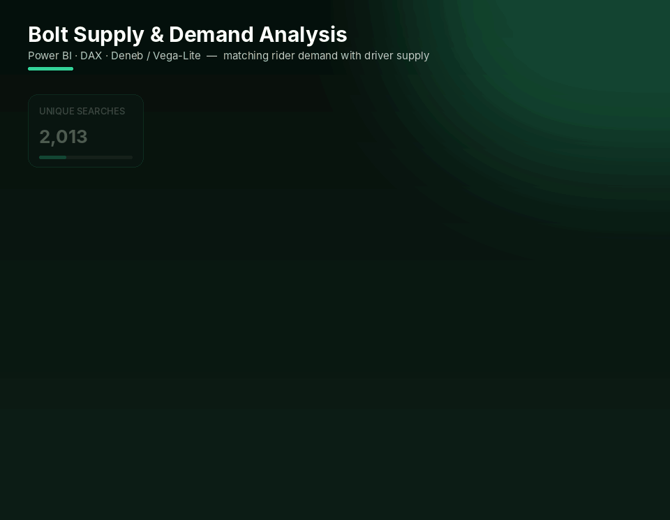
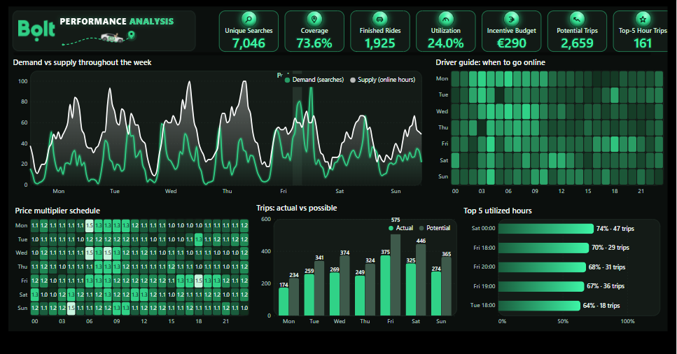

# 🚕 Bolt Supply & Demand Performance Analysis

   

*A Bolt-branded, fully cross-filtered dashboard that matches rider demand with driver supply — hour by hour, day by day.*

## 📸 Dashboard

🔍 View full-resolution static screenshot

 

---

## ❓ Business questions

- When do riders search for a car but no driver is available?
- Which hours have the highest utilization and the biggest missed-trip opportunity?
- When should drivers go online to maximize earnings?
- How does the price multiplier (surge) behave across the week?

## 🗂 Data

Ride-hailing operational data in three related tables — **Searches** (unique searches, searches with no car, coverage %, price multiplier), **Activities** (online hours, booking hours, total rides) and **Hours / Calendar** dimensions.

## 📊 What's inside

- **Demand vs supply throughout the week** — unique searches against online driver hours
- **Driver guide: when to go online** — hours where demand exceeds supply
- **Price multiplier schedule** — surge pattern by weekday and hour
- **Trips: actual vs possible** — completed rides vs estimated trips at maximum coverage
- **Top 5 utilized hours** — where the fleet is busiest
- Custom **Deneb (Vega-Lite)** visual, 1280×720, fully cross-filtered, styled in Bolt brand colors

## 🔢 Headline KPIs

| Unique searches | Coverage | Finished rides | Utilization | Potential trips | Incentive budget |
|:-:|:-:|:-:|:-:|:-:|:-:|
| **7,046** | **73.6%** | **1,925** | **24.0%** | **2,659** | **€290** |

## 💡 Key insights

- Supply covers **73.6%** of demand — roughly **1 in 4 searches** finds no available car.
- Only **1,925 of 2,659** potential trips were completed: there is a clear gap between actual and possible trips on every weekday, largest on **Friday and Saturday**.
- Fleet utilization peaks on **Saturday 00:00 (74%)** and **Friday evenings 18:00–20:00 (67–70%)** — the best hours for drivers to go online.
- Price multipliers stay mostly between **1.0–1.3×**, with spikes up to **1.5×** in the early morning and evening peaks.

## 🧠 Skills demonstrated

- Custom visual design with Deneb / Vega-Lite specifications
- Star-schema data model with Calendar and Hours dimensions
- DAX KPIs: coverage %, utilization, estimated trips at max coverage
- Translating operational data into actionable guidance for drivers

---

## 🚀 How to open

1. Install [Power BI Desktop](https://www.microsoft.com/power-platform/products/power-bi/desktop) (free).
2. Download **`bolt-supply-demand-analysis.pbix`** from this repository.
3. Open it in Power BI Desktop and interact with the slicers and visuals.

---

Built by <a href="https://github.com/Ali-Isa-Ashrafli"><b>Ali Isa Ashrafli</b></a> · Data Analyst · Baku, Azerbaijan 
⭐ If you find this project useful, consider giving it a star!

